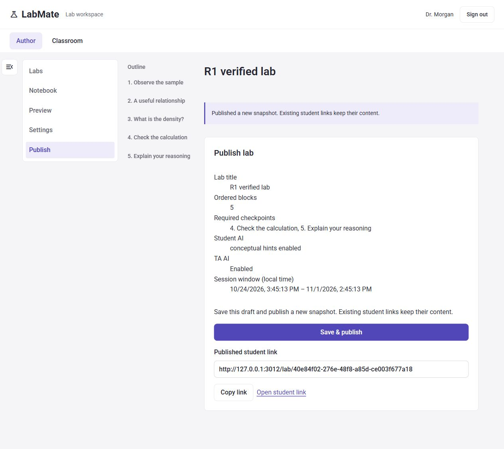

# R1 — Teacher authoring and integration

Status on 2026-10-25: implementation and automated gates pass; manual acceptance is partial. Do not mark the complete R1/G2/G3 rehearsal passed.

## Ownership and commits

- Person 1 work on `codex/r1-authoring`, starting at `6173842` (integrated notebook/R4 baseline). Only `main` existed locally at start; the other three people's branches/checkouts were not available to confirm. No other owner's feature files were changed.
- `683b543` — local authoring validation, publish review/fallback, G1 guard regression, snapshot/assignment tests.
- Shared entry points and renderer injection remain compatible. No schema, dependency, lockfile, endpoint or public/private transport changes.
- Existing shared shell/Student G1 integration arrived through the notebook commits already in baseline; do not cherry-pick it again. This R1 commit extracts the shell guard for independent testing.

## G1 callback contract

`onDirtyChange?: (dirty: boolean) => void` reports whether any student answer has unsaved edits. R2 reports clean only after confirmed save/discard, and reports false on unmount. Polling must not clear unsaved state. App passes a stable callback directly (the integrated implementation does not need StudentWorkspace). It guards publication switching, sign-out and the home link. Cancel must preserve identity, selection and values. Confirmed transitions clear shell state; My labs keeps the existing student mounted. Assistant rendering stays injected by the shell.

`tests/integration.test.ts` drives a simulated dirty callback through clean, dirty/cancel, dirty/confirm and clean-after-save/unmount reports. It verifies the shared guard, not DOM event wiring or native browser unload dialogs.

## Implementation

- Authoring-local validator identifies field/block errors before PUT or publish, opens the offending page/cell, focuses its input, and retains the entered draft. Error links revisit each offending field. Server Zod validation remains authoritative; invalid partial drafts are not persisted.
- Covers checkpoint answer references, numeric answer/units compatibility, automatic-rule requirements, private rubrics, session order, image HTTP(S)/alt text, field limits and required checkpoints for publishing.
- Empty numeric inputs stay empty instead of silently becoming zero; empty session inputs stay empty and are rejected before save.
- Publish review lists title, block count, required checkpoints, AI policy/settings and local session window. Publishing explicitly creates a new snapshot/link.
- Clipboard failure (including missing clipboard API) selects the visible read-only link and gives manual copy instructions.
- Failed requests retain the in-memory draft. Existing published snapshots and private projection boundaries are unchanged.

## Automated evidence

Node 24.14.0; `npm ci` installed the unchanged lockfile (0 reported vulnerabilities). Initial baseline checks could not run until dependencies were installed. The full final suite includes all 21 original tests and 7 new tests.

- `npm run typecheck`: passed.
- `npm test`: 28/28 passed. Sandbox loopback restrictions initially caused EACCES for Supertest; rerun with approved local network execution passed.
- `npm run build`: passed.
- `git diff --check`: passed before implementation commit.
- Invalid references, units and session order reject save and publish. Missing required checkpoint rejects publish. Every rejected publish leaves publication count unchanged.
- Publish A, join/submit/check as an independently authenticated student, edit content/settings and publish B: A's stored snapshot and complete student response remain identical; B matches edited draft. Teacher and both seeded TAs independently authenticate and open B's staff endpoint. Student projection excludes private grading fields.
- Local validation retains entered data and locates invalid image, numeric and date fields.

## Browser evidence

Dedicated ignored `data/r1-verification.sqlite`, explicit mock AI, local server on port 3012; no live provider request. Production UI used independent teacher/student sign-ins sequentially. Existing demo database was not reset.

Verified in the browser:

- Teacher opens the seeded notebook; empty lab title shows a useful error and focuses Lab title without losing cells.
- Add image, save with empty URL/alt: both errors shown and URL focused; image can be deleted.
- Publish summary displays all required review fields.
- Save & publish succeeds, displays a new student link and immutable-snapshot confirmation.
- Teacher switches to Classroom and opens the newly published session's queue.
- Student notebook renders with the existing answer entry UI.

The attempted dirty-student sign-out produced a browser-tool mouse-dispatch timeout around the native confirm dialog. On the next observation the session was signed out and no dialog handle remained. This is **not** evidence that Cancel preserved work. Native dialog acceptance/cancellation was not controllable reliably in this run.

## Remaining acceptance / integration coordination

- Repeat the full student publication-switch, sign-out and home cancel/discard/save matrix in a browser that exposes native dialogs reliably; check reload/unload separately with R2.
- Complete the all-six-block add/edit/move/delete/preview matrix, forced save-failure recovery and denied-clipboard fallback in the browser. These were inspected in source, but only the subset above was exercised in this run. Existing Python runner tests pass; no fresh CDN Python execution was claimed.
- Obtain R2 and R3 route handoffs, inspect their changed paths, and integrate only missing commits. R4 evidence is already present in baseline.
- Person 1 coordinates G2 using a dedicated database, independent student/two-TA sessions, explicit AI mode and the roadmap's combined rehearsal. G3 additionally requires a fresh live smoke on the demo machine. Neither gate is claimed here.
