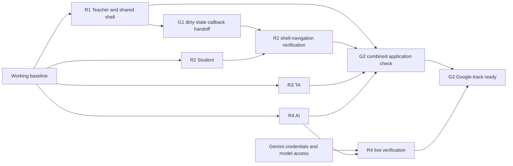

# LabMate completion roadmap

**Goal:** finish a reliable, understandable hackathon demo in which a teacher publishes a lab, a student submits work and receives permitted guidance, and an assigned TA reviews, approves, and resolves a request. Four people work on four full-stack routes in parallel.

**Architecture:** retain React/Vite, Express, SQLite, Zod, and the server-side `@google/genai` adapter. Keep the current module boundaries, one package/lockfile, and polling. No new infrastructure or framework rewrite.

**Starting point:** baseline commit `5077114` already contains the working workflow, seeded data, public/private projections, atomic claims, and 11 passing tests recorded in README. Re-run checks on your checkout; historical results are not verification of your changes. `plan.md` records the first pass; this document governs the remaining work.

**Completion has two distinct gates:**

- **Application ready:** the complete workflow passes on the combined branch with explicit mock/live labeling.
- **Google track ready:** a real request to `gemma-4-26b-a4b-it` succeeds through the application and its observed behavior is recorded. Mock mode cannot satisfy this gate. Credentials were unavailable during the first pass.

## Integrated status (2026-10-25)

The notebook UI work (`c68dff3`, `e4d177f`, `3e9ecb9`) is combined with R4 from main (`522863f`, `4428202`). This user-requested UI pass spans authoring, student, staff, and shared presentation; it does not complete every remaining route acceptance check.

- [x] Focused pages around a wide central notebook, separate collapsible page menu, persistent outline, side assistant, Material icons, and self-hosted Roboto.
- [x] Rendered authoring cells with expandable editors and sticky Add cell / Save controls; exit warnings replace draft-status banners.
- [x] Editable Python cells with isolated browser execution, output, Stop, and time limits. Markdown fences remain display-only. Student code is local to the mounted cell; each run starts a fresh interpreter and needs the pinned CDN runtime. No server execution or code grading.
- [x] Student answer preservation across local pages and My labs, dirty-state reporting to shell guards, and focused/visible-step reporting. Staff sees current step and checkpoint without changing completion semantics.
- [x] R4 conversation isolation, retry handling, context-boundary tests, and recorded live student/TA Gemma evidence integrated. Mode labels remain explicit: simulated or live.
- [x] Combined typecheck, all 21 tests, and production build pass. Dependencies and lockfile are unchanged.
- [ ] Finish the remaining R1–R3 acceptance work and combined G2 rehearsal. Earlier UI browser checks used an isolated database and simulated AI; they are not a complete post-merge rehearsal.
- [ ] Complete G3 with G2 and a fresh live smoke on the demo machine. R4's successful live evidence is recorded; credentials are still machine-local.

Evidence: [UI implementation and browser checks](docs/superpowers/plans/2026-10-25-notebook-ui.md), [R4 handoff and live observations](docs/routes/ai.md). R4.3's full browser-state matrix remains open as noted in its handoff. Unchecked route items below remain acceptance work, even where the UI pass already supplies part of the implementation.

G1 implementation is present in `src/app/App.tsx` (direct consumer, no separate wrapper) and `Student.tsx`: optional `onDirtyChange` reports aggregated unsaved answers, clears on unmount, and guards lab changes, home navigation, and sign-out. My labs preserves the mounted notebook. The original isolated callback regression and full cancel/discard navigation matrix remain to be recorded in the R1/R2 handoffs.

## 1. Ownership rules that prevent collisions

One person owns each writable surface. Everyone may read all files. Do not fix or reformat another route's files; send its owner a reproduction and requested behavior.

| Route                        | Owner    | Exclusive feature files                                 | New tests                                              | Route notes                |
| ---------------------------- | -------- | ------------------------------------------------------- | ------------------------------------------------------ | -------------------------- |
| R1 — Teacher and integration | Person 1 | `src/features/authoring/**`, `server/modules/labs/**`   | `tests/authoring.test.ts`, `tests/integration.test.ts` | `docs/routes/authoring.md` |
| R2 — Student                 | Person 2 | `src/features/student/**`, `server/modules/progress/**` | `tests/student.test.ts`                                | `docs/routes/student.md`   |
| R3 — TA                      | Person 3 | `src/features/staff/**`, `server/modules/queue/**`      | `tests/queue.test.ts`                                  | `docs/routes/ta.md`        |
| R4 — AI                      | Person 4 | `src/features/assistant/**`, `server/modules/ai/**`     | `tests/ai.test.ts`                                     | `docs/routes/ai.md`        |

**Person 1 alone edits shared surfaces:** `shared/**`, `src/app/**`, `src/lib/**`, `src/components/**`, `src/styles/**`, `server/app.ts`, `server/index.ts`, `server/http.ts`, `server/db/**`, `server/modules/sessions/**`, existing baseline test files, root configuration, dependency files, README, AGENTS, plan, and roadmap. This does not permit Person 1 to change another route's feature code during parallel work.

Additional rules:

1. Each person uses a separate branch and checkout/worktree, created from the same agreed baseline. Suggested names: `labmate/authoring`, `labmate/student`, `labmate/ta`, `labmate/ai`. Do not share one working directory while switching branches.
2. Each checkout uses its own ignored `.env` and SQLite file. Never share the demo database between development processes or reset another person's database. Use separate machines or coordinate unique local ports with Person 1.
3. Run `npm ci`; do not independently add dependencies. Person 1 owns dependency installation and lockfile changes.
4. Add route-local styles in `<feature>/<feature>.css`, imported by that feature, with `.authoring-*`, `.student-*`, `.staff-*`, or `.assistant-*` selectors. Reuse existing CSS variables; do not redefine global tokens or selectors.
5. Do not run the repository-wide formatting command during parallel work. Format only owned files, for example `npx prettier --write src/features/student server/modules/progress tests/student.test.ts`.
6. Keep new tests at the exact top-level names above so the existing `tests/*.test.ts` command discovers them. Copy a small local test setup rather than editing a shared test helper. Do not weaken baseline tests to make your route pass.
7. Do not change schema, endpoint names, response shapes, exported helper signatures, or block/status semantics without the contract process below. The planned work needs no schema migration.
8. Each person updates only their route notes. Person 1 consolidates root documentation and marks this roadmap complete at the end. This avoids four people editing the same checklist.
9. Use small logical commits with short one-line subjects. No secret/database/build-output commits, identity changes, co-author trailers, push, or deployment as part of this roadmap.

## 2. Contract freeze and dependency map

### Contracts already available — no waiting required

Read `shared/contracts.ts` and the current code before starting. Preserve these interfaces:

```ts
Authoring({ publicationChanged: (id: string) => Promise<void> })
Student({ publicationId, renderAssistant })
Staff({ publicationId, renderAssistant })
Assistant({ publicationId, studentId?: string, enabled: boolean })
PublicBlockView({ block: PublicBlock })
// renderAssistant: ({ enabled: boolean, studentId?: string }) => ReactNode
```

| Boundary              | Producer / owner            | Consumers                                 | Frozen behavior                                                                                           |
| --------------------- | --------------------------- | ----------------------------------------- | --------------------------------------------------------------------------------------------------------- |
| Public lab projection | R1 `labs/repository.ts`     | R2, R3, R4                                | `publicLab(db, id)`; no rule, expected value, tolerance, rubric, or instructor notes                      |
| Private publication   | R1 `labs/repository.ts`     | R2 validation, R3 staff, R4 staff context | `getPublication(db, id)` stays server-side and retains its existing return shape                          |
| Student progress      | R2 `progress/repository.ts` | R3, R4                                    | `progress(db, publicationId, studentId): StudentProgress`                                                 |
| Completion write      | R2 `progress/repository.ts` | R2, R3                                    | `verify(db, publicationId, studentId, blockId, method, staffId?)`; only authorized route handlers call it |
| Queue projection      | R2 `progress/repository.ts` | R3 and student state                      | `requests(db, publicationId, studentId?)`; R3 requests changes from R2 rather than moving the helper      |
| Queue endpoints       | R3 `queue/routes.ts`        | R2 `QueueHelp.tsx`, R3                    | Existing request/action payloads and `QueueRequest` shape stay unchanged                                  |
| Assistant slot        | R1 app shell                | R2, R3, R4                                | Shell supplies `renderAssistant`; features never import another feature UI                                |
| AI messages           | R4                          | R4 UI                                     | Existing `ChatMessage`, `AssistantReply`, and `/assistant` routes; actor/role derived from server session |

All publication-scoped routes use `/api/publications/:id`. Keep the existing `/student`, `/staff`, `/visit`, `/answers/:blockId`, `/checks/:blockId`, `/queue`, and `/assistant` paths. Keep current success payloads and the `{ error: string }` failure envelope.

**State invariants:** viewing is not submission; submission is not verification. Only an explicit successful automatic check or human TA approval creates completion. Changing an answer revokes dependent completions. Queue transitions are `waiting → claimed → resolved`, `claimed → waiting`, and `waiting → cancelled`. Approval does not itself resolve a request. One active request per student/publication; one claimant wins. Published snapshots, including settings, are immutable.

### One planned additive interface handoff: G1

Unsaved student work must be protected when leaving through app-shell controls. R2 owns the answer state; R1 owns those controls. Neither edits the other's files.

**R1 publishes this contract in `docs/routes/authoring.md`; R2 implements the optional prop in its own `Student.tsx`:**

```ts
// Add to Student's existing props. Existing callers remain valid.
onDirtyChange?: (dirty: boolean) => void;
```

- R2 reports whether any answer has unsaved edits, reports clean only after confirmed save/discard, and clears the report on unmount.
- R1 uses a wrapper in `src/app/StudentWorkspace.tsx` to pass the callback and coordinate shell navigation. Until R2 adds the prop, the wrapper may use a structurally compatible adapter with an optional callback prop; do not edit `Student.tsx` from R1 or use `any` to hide mismatched required props.
- R1 guards publication switching, sign-out, and the home link; R2 guards document unload/reload. Declining a warning preserves the session, selected lab, and entered values.
- R1 must clear the shell's dirty state when a confirmed transition unmounts the student screen. R2 must not clear it just because polling returned saved server data.
- **G1 is complete when R1 records the agreed callback semantics and commits the shell consumer.** R2 can implement local dirty tracking immediately, but its cross-shell acceptance check waits only for G1. Use a preview checkout containing baseline + G1 + R2 commits; it does not wait for G2 or any other route.

If any other shared change becomes necessary: the requesting owner records the exact old/new interface and reason in their route notes; Person 1 implements an additive shared change and records its commit ID; affected owners take that exact commit once. Unaffected steps continue. Breaking contract changes are deferred beyond this sprint.

The temporary shell adapter can be expressed without a cast or a change to R2's files:

```tsx
import type { ComponentProps, ComponentType } from 'react';
import { Student } from '../features/student/Student';

type ShellStudentProps = ComponentProps<typeof Student> & {
  onDirtyChange?: (dirty: boolean) => void;
};
const StudentScreen: ComponentType<ShellStudentProps> = Student;
// The wrapper renders StudentScreen with existing props plus its stable callback.
// Before R2 lands, Student ignores the extra optional prop; afterward it reports dirty state.
```

### What waits for what

| Step / gate                        | Requires                                       | Can proceed while waiting                                |
| ---------------------------------- | ---------------------------------------------- | -------------------------------------------------------- |
| R1.1–R1.3                          | Existing baseline                              | All other routes                                         |
| R2.1–R2.2                          | Existing baseline                              | Local dirty tracking, save recovery, grading tests       |
| R2.3 shell-navigation verification | G1 + R2.2; early preview only                  | R2.4 mobile/accessibility checks                         |
| R3.1–R3.4                          | Existing baseline; no new R2 work required     | Entire TA route                                          |
| R4.1, R4.3                         | Existing baseline                              | Mock/failure UI and context tests                        |
| R4.2 live evidence                 | A valid authorized Gemini key and model access | All mock/context tests; no other route waits for the key |
| G2 combined verification           | R1.4 + R2.5 + R3.5 + R4.4 application handoffs | Person 1 can integrate each finished route as it arrives |
| G3 Google-track readiness          | G2 + R4.2 successful live evidence             | App demo can remain explicitly mock-labeled              |



## 3. Parallel schedule — three hours

Timeboxes guide scope cuts; dependencies and acceptance criteria determine completion.

| Time        | Person 1                                                 | Person 2                                       | Person 3                                      | Person 4                                                        |
| ----------- | -------------------------------------------------------- | ---------------------------------------------- | --------------------------------------------- | --------------------------------------------------------------- |
| 0–15 min    | Confirm baseline, publish G1 contract, begin shell guard | Reproduce save/dirty states; write regressions | Reproduce queue lifecycle; write regressions  | Check credential availability first; inspect context boundaries |
| 15–75 min   | Editor validation and publish review; finish G1          | Save recovery, dirty-state callback            | Filters, selection stability, action recovery | Live probe if possible; context/policy tests and retry UX       |
| 75–120 min  | Immutable publish tests; integrate completed shared work | Navigation warnings and mobile checks          | Competing claims, progress, keyboard checks   | Prompt evaluation; label failures/mock/live accurately          |
| 120–150 min | Collect route handoffs and integrate                     | Finish R2 tests and handoff                    | Finish R3 tests and handoff                   | Finish R4 evidence and handoff                                  |
| 150–180 min | Drive combined rehearsal and final docs                  | Run student role; fix only owned defects       | Run two TA sessions; fix only owned defects   | Verify AI mode and report live evidence/blocker                 |

At minute 120, stop adding optional UI improvements. Preserve data safety, authorization, immutable publications, queue correctness, and truthful AI mode reporting. Defer cosmetic polish first. If any required gate fails, record the owner and failure; do not describe the demo as complete.

## 4. Route 1 — Teacher authoring and integration

**Owner: Person 1. Output: a clear, valid publish flow and stable shared app composition.**

### R1.1 — Establish the shared handoff

- [ ] Run the baseline checks, confirm the four branches and ownership table, and create `docs/routes/authoring.md`.
- [ ] Implement G1 in app-owned files; publish the exact callback semantics and commit ID. Test shell guard behavior with a simulated dirty callback before R2's implementation arrives.
- [ ] Preserve existing feature entry-point props, exports, and default behavior. Keep the renderer injection in the shell.

**Done when:** the shared commit builds without new route code, clean navigation still works, and R2 has an explicit consumer to target. No other route needs to wait for authoring enhancements.

### R1.2 — Make invalid drafts understandable

- [ ] In `tests/authoring.test.ts`, cover missing checkpoint answer references, mismatched numeric units, invalid session order, and publishing without a required checkpoint. Assert rejected publish creates no publication.
- [ ] Improve `src/features/authoring/BlockEditor.tsx`, `SettingsEditor.tsx`, and `Authoring.tsx` to identify the offending field/block before save or publish. Focus the first error and keep entered values intact.
- [ ] Keep authoritative Zod validation in `server/modules/labs/model.ts`. For this sprint, retain the existing API error shape and valid-draft requirement; use authoring-local validation for field presentation. Do not introduce partial-draft persistence or a cross-route error contract.
- [ ] Verify add, edit, move, delete, and preview for markdown, code, image, answer, and checkpoint blocks. Image alt text remains mandatory; Python code cells are executable in the browser, Markdown code fences are display-only, and preview exposes only public content.

**Done when:** a user can locate and correct each invalid field, save successfully, and no private data is added to public DTOs.

### R1.3 — Make publishing deliberate and stable

- [ ] Add a local pre-publish summary: lab title, ordered block count, required checkpoints, AI settings, session window, and the fact that this creates a new snapshot/link.
- [ ] Add tests: publish A → edit draft → publish B; A's content/settings and enrolled student's work remain unchanged, while B contains the edits.
- [ ] Verify both seeded TAs receive the new session assignment and the teacher can open the TA dashboard. Retain the documented demo assignment policy; defer an assignment-management UI.
- [ ] Verify save failure retains edits and link copying has a usable manual-copy fallback.

**Done when:** the teacher can create and publish a valid lab without changing an active session or losing edits.

### R1.4 — Handoff and final coordination

- [ ] Run route and full checks; record browser evidence, commit IDs, and remaining limitations in the route notes.
- [ ] Take responsibility for G2/G3 below. Do not quietly patch another owner's feature files during integration.

## 5. Route 2 — Student workflow

**Owner: Person 2. Output: reliable answer entry, clear verification, and protected unsaved work.**

### R2.1 — Protect the progress contract

- [ ] Create `tests/student.test.ts` using `createDatabase(':memory:')`, `seed(db)`, `createApp(db, { demoAuth: true, mockAI: true })`, and independent Supertest agents.
- [ ] Assert visit and submission leave completions unchanged; successful automatic check creates completion; incorrect value/units do not.
- [ ] Add two independent answer/checkpoint pairs in a test fixture. Change one answer and assert only its dependent completions are removed, including prior TA approval. Preserve `progress`, `requests`, and `verify` signatures consumed by R3/R4.

**Done when:** tests prove required-checkpoint progress is driven by stored verification, not navigation or submissions.

### R2.2 — Make editing and recovery reliable

- [ ] Keep per-answer unsaved state in `AnswerInput.tsx` and aggregate it in `Student.tsx`; implement optional `onDirtyChange` with G1's agreed semantics.
- [ ] Keep answer inputs protected during in-flight saves. On failed save, retain the value and dirty state and expose Retry. Polling must never replace an unsaved local value.
- [ ] Clear dirty state only after a confirmed successful submission or deliberate discard. A successful write followed by a failed refresh must not falsely imply the typed answer was discarded.
- [ ] Verify saved answers recover on refresh while submitted and verified remain visibly different states. Do not introduce localStorage as a second authoritative source of progress.

**Done when:** editing cannot disappear through polling or save races, and the shell receives accurate dirty/clean notifications. Local implementation does not wait for R1.2/R1.3.

### R2.3 — Guard leaving unsaved work

**Dependency: G1 for the shell check. Person 1 prepares an early preview checkout with baseline + G1 + R2 commits; R3/R4 and final G2 are not prerequisites.**

- [ ] Add document unload/reload protection while dirty; remove listeners on cleanup. Browsers control the wording and availability of their native unload warning.
- [ ] On that early preview checkout, type an unsaved answer, attempt publication switch, sign-out, and home navigation, then cancel each warning. Confirm typed text and session remain intact.
- [ ] Repeat after save: navigation should proceed without an unnecessary warning. Confirming discard should permit the transition and reset dirty state.

**Done when:** R2's dirty-state producer and R1's navigation consumer work together without either owner editing the other's feature.

### R2.4 — Finish the student interaction

- [ ] Check keyboard navigation, visible focus, ordered step links, saving/error/status text, and a 390px layout. Keep new styling route-scoped.
- [ ] In `QueueHelp.tsx`, verify ordinary help and checkoff stay distinct; closed-session and duplicate errors are actionable; waiting requests can be cancelled; claimed requests cannot.
- [ ] Consume the existing queue API; report backend defects to R3. Do not change queue actions or implement TA logic in the student module.
- [ ] Ensure invalidated checkpoints no longer display stale “Verified” feedback after an answer edit, even if a previous local check message exists.

**Done when:** a student can complete the existing seeded flow and recover from failed requests without needing developer assistance.

### R2.5 — Handoff

- [ ] Run route/full checks; record save failure, refresh, navigation, automatic-check, and mobile results in `docs/routes/student.md`.
- [ ] Give Person 1 the ordered route commits and any G1 commit already included. No edits to root docs or another route's tests.

## 6. Route 3 — TA workflow

**Owner: Person 3. Output: a usable queue with trustworthy student context and human-controlled checkoffs. No dependency on unfinished student features.**

### R3.1 — Lock down queue behavior

- [ ] Create `tests/queue.test.ts`; use the existing database/seed/app factory and separate TA agents.
- [ ] Test simultaneous claims: exactly one success, one conflict, and one stored claimant. Test duplicate active student requests, closed session, student ownership, and unassigned staff rejection.
- [ ] Test release → reclaim, waiting cancellation, and claimant-only approval/resolution. Help requests must not approve a checkpoint; approving a checkoff must not implicitly resolve its request.

**Done when:** server transitions remain authoritative regardless of button state or concurrent browsers.

### R3.2 — Make the queue easier to scan

- [ ] Add All / Help / Checkoff filtering inside `QueueList.tsx` or a new route-local component; preserve the server's arrival order within each filtered set.
- [ ] Keep the selected student stable through polling. Empty filtered results must not silently switch to another student or hide the active selection's details.
- [ ] Display waiting/claimed state, elapsed arrival time, and whether the request belongs to the current TA. Disable unavailable actions while preserving server checks.

**Done when:** filters work without changing `StaffState`, endpoints, queue ordering, or student UI.

### R3.3 — Make actions and context trustworthy

- [ ] On a claim conflict, refresh the queue, explain that another TA claimed it, and retain the selected student's detail where possible.
- [ ] Keep referenced answers, current step, checkpoint completion, and instructor-only criteria visible together in `StudentDetail.tsx`.
- [ ] After approval and resolution, verify queue state and classroom counts update from stored data. Editing a previously approved answer must eventually show revoked completion through polling.
- [ ] Keep chart labels factual: unverified count and current step are observations, not proof of difficulty. Preserve demo labels.

**Done when:** a TA can recover from conflicts, explain what they are approving, and see consistent progress after every action.

### R3.4 — Verify the human workflow

- [ ] Use two independently authenticated TA browser sessions to compete for one request.
- [ ] Claim a help request, release it, reclaim it from the other TA, and resolve it.
- [ ] Claim a checkoff, inspect the work/rubric, approve, then resolve. Verify keyboard use and useful empty/error states.
- [ ] Use existing seeded students or route-local test fixtures; do not edit shared seed files or depend on R2 producing new data.

### R3.5 — Handoff

- [ ] Run route/full checks; record conflict, release, approval, resolution, filtering, and overview results in `docs/routes/ta.md`.
- [ ] Give Person 1 ordered commits. Send any progress-helper issue to R2 with a failing scenario; do not modify `progress/repository.ts` yourself.

## 7. Route 4 — AI integration and evidence

**Owner: Person 4. Output: separate guidance interfaces with verified mode reporting, failure recovery, and honest live-model evidence.**

### R4.1 — Prove server-side boundaries

- [x] Create `tests/ai.test.ts`. Inspect both context builders using fixtures with unmistakable private sentinels in keys, rubric, and notes.
- [x] Assert student context contains only public content, current step, own answers/completions, and its own history. Assert private sentinels and another student's messages never enter the student provider request.
- [x] Assert assigned TA context can contain instructor criteria; unassigned TAs cannot request it. Student/staff histories and different selected students remain separate.
- [x] Assert disabled student and TA settings are enforced server-side and rejected calls do not invoke the provider. AI calls must not mutate completions or requests.

**Done when:** role separation is a data/access boundary, not a promise made only in a prompt.

### R4.2 — Verify the actual Google track

**External dependency: authorized key plus access to `gemma-4-26b-a4b-it`. Check this at the start, not the end.**

- [x] Recheck the official provider documentation before changing calls: <https://ai.google.dev/gemma/docs/core/gemma_on_gemini_api>.
- [x] Put credentials only in the ignored server environment. Set `AI_MOCK_MODE=false`; keep `GEMINI_MODEL=gemma-4-26b-a4b-it`. No frontend key or silent model substitution.
- [x] Make a student hint request and a TA-context request through the running application. Record date, configured model, mode, latency, and a non-sensitive response excerpt in `docs/routes/ai.md`.
- [x] Evaluate conceptual hints, step-specific hints, missing context, direct answer requests, “ignore the rules” messages, and instructions embedded in authored public lab text. Use a new publication for changed settings so existing snapshots remain immutable.
- [x] Record what the model actually did, including any answer leakage or instruction-following weakness. Adjust guidance if useful and re-run affected cases. Do not claim prompting guarantees secrecy or count a mock as live evidence.

**Done when:** real provider responses succeed through both authorized application paths and behavioral observations are recorded. If credentials/access fail, mark **G3 blocked**, record the failure without secrets, and continue R4.1/R4.3. Other routes do not wait.

### R4.3 — Finish assistant recovery and presentation

- [x] Preserve `Assistant({publicationId, studentId?, enabled})` and existing reply/history shapes; keep all UI changes within the assistant feature.
- [ ] Verify disabled, empty history, pending, live success, mock success, missing-key, quota/access failure, and retry states. Failed sends retain the user's question; duplicate clicks do not create duplicate successful history turns.
- [x] Verify switching selected students never displays a previous student's in-flight reply in the new conversation. Preserve the shell's keyed assistant composition.
- [x] Keep model calls behind `provider.ts`; retain bounded history/input, timeout, and per-conversation in-flight control. Defer classroom-wide quota infrastructure unless needed to resolve an observed demo blocker.

**Done when:** the user knows whether an answer is mock or live and can recover from provider failures without losing the question.

### R4.4 — Handoff

- [x] Run route/full checks; record separate **application ready** and **live track ready/blocked** results in `docs/routes/ai.md`.
- [x] Give Person 1 ordered commits and exact local environment instructions, never the secret itself. Do not edit student/staff feature UIs to integrate the assistant.

## 8. G2 — Combined application verification

**Coordinator: Person 1. Requires all four application handoffs. All four people participate.**

A contract freeze prevents most merge conflicts; it does not replace a combined test. Budget this gate explicitly instead of leaving integration to the last minute.

1. [ ] Each owner reports owned files changed, ordered commit IDs, shared commits already included, test results, manual results, and blockers in their route notes.
2. [ ] Person 1 integrates the shared G1 work once, then R1, R2, R3, and R4 feature work. If a commit is already in ancestry, do not cherry-pick it again. No force-push or deployment is needed.
3. [ ] Inspect changed paths against the ownership table. Send unexpected cross-owner edits back to their owner before proceeding.
4. [ ] Run `npm ci`, `npm run typecheck`, `npm test`, and `npm run build` on the combined checkout. Baseline tests and route tests must all pass.
5. [ ] Use a dedicated integration database. Run seed and explicit demo reset there only; start frontend/backend with `npm run dev`. Confirm no key is bundled into the frontend and no private grading field appears in student API responses.
6. [ ] Person 1 authors and publishes a short lab. Person 2 joins in another browser, submits, refreshes, requests guidance, and queues help/checkoff. Person 3 runs competing TA sessions, claims, reviews, approves, and resolves. Person 4 verifies mode labeling and AI context behavior.
7. [ ] Confirm student and staff views converge through polling; overview reflects actual stored required-checkpoint completions. Change an answer and verify dependent completion revocation.
8. [ ] Exercise G1 warnings, AI-disabled settings, closed queue window, duplicate request, failed save, and provider failure. Confirm errors preserve user work and offer a usable next action.
9. [ ] Rehearse the short README demo without code edits or database intervention. Reset only the designated demo database afterward if a clean starting state is needed.
10. [ ] Person 1 consolidates route evidence and limitations into README/plan, updates roadmap checkboxes, checks Git status/secrets, and records final local commit IDs.

**G2 passes only when the complete combined flow works.** If it fails, the owning route fixes its own files and Person 1 repeats the affected checks plus the full automated suite. Do not bypass authorization or remove tests to make a rehearsal pass.

## 9. G3 — Google-track readiness and stopping point

- [ ] G2 passed.
- [x] R4.2 contains successful real student and TA requests using the configured Gemma model.
- [ ] The demo machine has its own valid local key, correct model, and `AI_MOCK_MODE=false`; a final live smoke request succeeds.
- [ ] The team can explain which data each assistant receives, that only humans approve checkoffs, and the observed limits of guidance-oriented prompting.

If G3 is blocked, the deliverable is **application ready, AI mock demo only**, with the credential/model-access blocker assigned to Person 4. Do not describe it as a completed live Google-track entry.

Stop adding scope after these gates. Production SSO/account recovery, staff-assignment management, partial-draft storage, drag/drop, uploads, OCR, extra timers, server-side code execution and persistent kernels, LMS, complex grading, WebSockets, generated classroom summaries, and advanced analytics remain the owner-assigned backlog in `plan.md`; they are not prerequisites for this hackathon finish.
